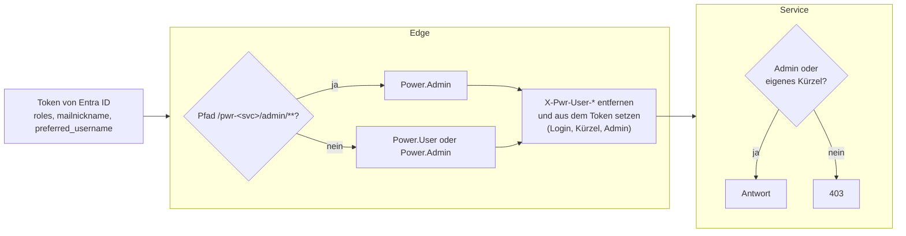
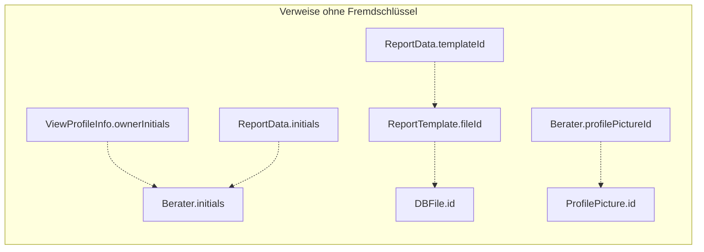

# 8. Querschnittliche Konzepte

Die verbindlichen Regeln stehen nur in [`AGENTS.md`](../../AGENTS.md#architecture). Dieses Kapitel beschreibt die Konzepte dahinter, ihre Zusammenhänge und Gründe, und verweist für die Regel selbst dorthin.

## 8.1 Sicherheit

Die Regeln (Anmeldung nur in der Edge, Identität nur aus den Identitäts-Headern, zwei Schichten für Admin-Pfade, nur eigene Daten) stehen in [`AGENTS.md` › Architecture](../../AGENTS.md#architecture); dieser Abschnitt beschreibt, wie sie umgesetzt sind.

- **Anmeldung:** Der Webclient meldet über MSAL (OIDC, Redirect) an Entra ID an. Jeder Aufruf trägt das Access-Token als `Authorization: Bearer` (`PowerHttpClient`); der Ablauf steht in [6.1](06-laufzeitsicht.md#61-anmeldung-und-ein-aufruf).
- **Was die Edge der Reihe nach prüft:**
  - Den Pfad (`NormalizedPathFilter`, #260): Sie weist mit `400` ab, was nicht normalisiert ist: Segmente `.` und `..`, `//`, `;`, kodierte `/`, `\` oder `%` und unnötig kodierte Zeichen wie `%2e` oder `%61`. Die Services normalisieren den Pfad selbst; sonst könnte ein Pfad, den die Edge nicht als `/admin` erkennt, beim Service auf einem Admin-Endpunkt landen. Deshalb prüfen die Services `/admin` zusätzlich selbst.
  - Das JWT: Signatur (Schlüssel vom Issuer), Issuer, Gültigkeit und Audience. Angenommen werden nur Tokens für die API von Power, deren `aud` einen der Werte aus `pwr.security.jwt.audiences` nennt, Client-ID oder App-ID-URI je nach Token-Version (`JwtDecoderConfig`, `AudienceValidator`, #324; ohne den Wert startet die Edge nicht).
  - Die Rolle je Pfad ([5.2.1](05-bausteinsicht.md#521-pwr-edge-service)).
  - Danach setzt sie die Identitäts-Header aus dem Token, nachdem sie gleichnamige Header des Clients entfernt hat; `X-Pwr-User-Admin` setzt sie auf jede Anfrage ([5.2.1](05-bausteinsicht.md#521-pwr-edge-service)).
- **Warum die Services den Headern glauben:** Sie sind nur im Container-Netz erreichbar. Spring Security nutzen sie erst mit einer eigenen Tokenprüfung ([ADR-24](09-architekturentscheidungen.md#adr-24-spring-security-in-den-backend-services-erst-mit-eigener-tokenprüfung)); das Risiko steht in [Kapitel 11](11-risiken-und-technische-schulden.md) (K2).
- **Nur eigene Daten** (#255, #350):
  - `ConsultantAccessInterceptor` vergleicht die Pfadvariable `{initials}` jedes Endpunkts mit `X-Pwr-User-Initials` (ohne Groß-/Kleinschreibung). Ohne `Power.Admin` und ohne Treffer ist die Antwort `403`; was für Anfragen ohne `X-Pwr-User-Admin` gilt, steht unter K2 in [Kapitel 11](11-risiken-und-technische-schulden.md#114-kommunikation-und-sicherheit).
  - `@ReadableByColleagues` tragen im Profile Service die GETs von Berater, Profileinträgen und Profilbild, nur für Anfragen mit Kürzel, Bilder nur aktiver Berater.
  - Offen für alle Benutzer, bewusst: die Beratersuche (`POST /statistics/consultant/find/skills`), `GET /consultants/names` und die Cluster-Info (`/statistics/network/consultant/{initials}`).
  - Dokumente entstehen nur über den View-Profile Service ([6.4](06-laufzeitsicht.md#64-dokument-exportieren-docx)): `POST /report` und `/report/preview` des Report Service antworten jeder Anfrage über die Edge mit `403`, auch einem Admin, ebenso bei einem Profilauszug, dessen Besitzer (`viewProfileInfo.owner`) nicht das Kürzel im Body ist.
  - Ein fremdes Profil zeigt der Webclient nur lesend und lädt nichts, was der Kollege nicht sehen darf: keine Bedienelemente zum Ändern, nur die Profilseiten (Übersicht, Profilauszüge und Dokumente führen zum Profil), das Menü führt zu den eigenen Seiten, `ColleagueProfileNotice` sagt, wessen Profil es ist. Kollegen findet man auf der Seite *Kollegen* (`/app/<eigenes>/colleagues`) und über die Namen in Beratersuche und Cluster-Info.
- **Binärdaten** (Profilbilder, Vorschauen) lädt der Webclient mit Token als Blob ([Regel](../../AGENTS.md#webclient), #65). Profilbilder dürfen privat lange gecacht werden (`Cache-Control: private, max-age=365d, immutable`, #67).
- **Datensparsamkeit:** `GET /consultants/names` gibt allen Benutzern nur Kürzel, Kurz- und vollen Namen und ob der Berater aktiv ist (#216, #350). `GET /consultants/{initials}` nennt das Geburtsdatum nur dem Berater selbst und Admins (#350).
- **Lokal** gibt es keine Edge und keine Anmeldung: Man ist Admin, die Header fehlen (z. B. bleibt „Exportiert von“ leer). Als Benutzer ohne Admin-Rolle startet man wie in [`README.md` › Start the webclient](../../README.md#3-start-the-webclient) beschrieben; dann prüfen die Services wie in Produktion (#350).
- **Lieferkette:** Wie Actions gepinnt und geprüft werden, steht in [`AGENTS.md` › CI](../../AGENTS.md#ci) (#8).

## 8.2 Persistenz

| Service | Speicher | Schema / Modell |
|---|---|---|
| Profile, Skill, Report | MariaDB, eine Datenbank je Service | JPA/Hibernate. Das Schema legt Hibernate an (`ddl-auto: update`, auch in der Produktion seit #27). |
| View-Profile Service, Statistics | Redis, eine logische Datenbank je Service | Spring Data Redis, ein Objekt als Hash mit einem Eintrag je Feld |
| Skill | zusätzlich Lucene-Index im Dateisystem | Hibernate Search, bei jedem Start neu aufgebaut |

- **Kein Migrationswerkzeug** ([ADR-08](09-architekturentscheidungen.md#adr-08-schema-mit-hibernate-ddl-auto-update-ohne-migrationswerkzeug)): Was Hibernate selbst anlegt und was ein SQL-Skript braucht, regelt [`AGENTS.md`](../../AGENTS.md#architecture) (*Schema management*). Das Skript läuft vor dem Merge ([7.2](07-verteilungssicht.md#72-vom-merge-in-die-produktion)).
- **Redis-Kompatibilität:** Was eine Änderung an einem Redis-Modell braucht, regelt die Definition of Done in [`AGENTS.md`](../../AGENTS.md#services) (#179). Standardwerte neuer Felder setzt im View-Profile Service `ViewProfileRestoreAspect`.
- **Hibernate-Fallen:** die `JOINED`-Vererbung von `ProfileEntry` mit Altdaten ohne Zeile eines Eintragstyps (#236), Zeilen, die aus Collections entfernt wurden, und der Hash eines `ProfileEntry`, der an seinem `NameEntity` hängt. Die Regeln dazu stehen in [`AGENTS.md`](../../AGENTS.md#architecture) (*Renaming, merging and deleting*, Punkt *Hibernate*).
- **Tests mit H2:** H2 verhält sich nicht ganz wie die MariaDB; die Regeln dazu (Groß-/Kleinschreibung, leeres `in ()`, `flush` in Lösch-Tests, #243) stehen in [`AGENTS.md`](../../AGENTS.md#architecture) unter *Names compare ignoring case*.

## 8.3 Konsistenz über Services

- Verweise zwischen den Services sind bloße Kürzel und IDs. Es gibt keine verteilte Transaktion.
- **Löschen über Services** geht von außen nach innen, und jeder Schritt lässt sich wiederholen. Ein Beispiel ist das Löschen eines Beraters ([6.7](06-laufzeitsicht.md#67-berater-löschen-admin)). Ein Abbruch lässt den eigentlichen Datensatz stehen; erneutes Löschen löscht den Rest.
- **Housekeeping** ([6.8](06-laufzeitsicht.md#68-housekeeping-admin), #242, [ADR-21](09-architekturentscheidungen.md#adr-21-housekeeping-je-service)); die Regeln stehen in [`AGENTS.md`](../../AGENTS.md#architecture) (*Housekeeping*):
  - Jeder Service antwortet auf `GET /admin/housekeeping` mit seinen Prüfungen (`HousekeepingFindings`: Schlüssel, Anzahl, bis zu zehn Beispiele, oder ein Fehler). Die Admin-Seite *Housekeeping* (`modules/admin/housekeeping`) fragt jeden Service für sich.
  - **Rubrik *Datenleichen***, die Prüfungen je Service:

    | Service | Prüfungen | liest dafür |
    |---|---|---|
    | Profile | Zeilen in `profile_entry` ohne Eintragstyp; Einträge, Projekte und Skills, die kein Profil hält; Profilbilder, die kein Berater zeigt | – |
    | Report | Dokumente unbekannter Kürzel; Dokumente, die nach einer Stunde noch `RUNNING` sind; Dateien, auf die keine Vorlage zeigt | `GET /consultants/names` (Profile), `GET /admin/template/files` (View-Profile Service) |
    | View-Profile Service | Profilauszüge unbekannter Kürzel oder ohne Besitzer; Vorlagen, deren Datei fehlt | `GET /consultants/names` (Profile), `GET /admin/file` (Report) |

  - Innerhalb des Profile Service entstehen keine mehr (#254): Einträge löscht `orphanRemoval`, Projekte `deleteProject`, Skills `SkillRows`, sobald weder Profil noch Projekt sie hält. `NoLeftoversITest` prüft jeden Weg gegen die Housekeeping-Prüfungen. Was das Housekeeping dort noch findet, sind Altdaten.
  - Daten ohne Profil ändern kein Profil; nach dem Bereinigen muss die Statistik nicht neu laden.
  - **Rubrik *Alt*** (#289): Daten, die wahrscheinlich niemand mehr braucht. Der Report Service meldet Exportdokumente älter als `pwr.housekeeping.old-reports-after` mit ihrem Speicherplatz (`/admin/housekeeping/old[/old-reports]`), der View-Profile Service Profilauszüge, die so lange weder geändert noch exportiert wurden (`pwr.housekeeping.old-view-profiles-after`, `/admin/housekeeping/old[/old-view-profiles]`); beide Standard 730 Tage. Die letzte Nutzung steht in `viewProfileInfo.lastUsed`, gesetzt vom automatischen Speichern und beim Export. Das jüngste Dokument und der zuletzt benutzte Profilauszug jedes Beraters bleiben immer; Berater werden nicht gefragt. Profilauszüge von vor #289 zählen als benutzt am Tag der Einführung, damit ein alter, kürzlich exportierter Profilauszug nicht als alt gilt.
  - **Rubrik *Unbenutzt*** (#288): gültige Einträge, die niemand mehr nutzt. Profil-Elemente je Typ meldet der Profile Service (`GET /admin/housekeeping/unused`), gelöscht wird über den Dialog mit allen Namen (`DELETE /admin/name-entities/unused?type=`); die Liste der Profil-Elemente hat dafür keinen Lösch-Knopf, nur einen Link ins Housekeeping. Eigene Skills, also die in der Kategorie *Other*, in die ein unbekannter getippter Skill kommt, deren Name und Aliase kein Profil nutzt, meldet und löscht der Skill Service (`GET /admin/housekeeping/unused`, `DELETE /admin/housekeeping/unused/unused-custom-skills`). Die Nutzung liest er beim Profile Service (`GET /admin/skills/usage`). Skills anderer Kategorien zählen nie dazu, auch nicht nach dem Verschieben aus *Other*; sie werden gepflegt. Die Zahlen passen zu den Nutzerzahlen der Listen (#271): unbenutzt ist, was dort `0` zeigt.
- **Abgeleitete Daten:** Die Statistik hält eine Kopie und lädt sie stündlich und nach Massenänderungen neu ([6.5](06-laufzeitsicht.md#65-statistik-aktuell-halten)).
- **Nutzungszahlen der Profil-Elemente** (#271): Die Listen im Admin-Bereich zeigen je Element und je Skill, wie viele Berater es nutzen. Die Zahlen kommen aus der Datenbank des Profile Service (`GET /admin/name-entities/usage?type=`, `GET /admin/skills/usage`), gezählt wie „unbenutzte löschen“ und mit der Liste neu geladen. Die Info-Box daneben nennt die Nutzer weiter aus der Kopie der Statistik. Nach Änderungen einzelner Profile kann sie bis zu einer Stunde hinter der Zahl in der Liste zurückliegen.
- **Momentaufnahmen:** Profilauszüge ändern sich nicht mit dem Profil. *Aktualisieren* übernimmt Änderungen bewusst (#230, #332, [6.3](06-laufzeitsicht.md#63-profilauszug-anlegen)).
- **Interner Vermerk** (#336): Eine Projektreferenz hat einen Vermerk nur für HBT, so lang wie die Beschreibung. Er bleibt im Profile Service ([Regel](../../AGENTS.md#architecture)). Im Projektformular ist er zugeklappt, bis man ihn öffnet.

## 8.4 Kommunikation zwischen Services

- REST mit JSON über `RestTemplate`. Die Basis-URL kommt aus `pwr-<name>-service-url`; Standard ist der Compose-Name, im Profil `localDev` `localhost`. Feign ist seit 2023 abgelöst ([ADR-03](09-architekturentscheidungen.md#adr-03-aufrufe-zwischen-services-mit-resttemplate)). Woher ein Client sein `RestTemplate` nimmt und wie Freitext in Query-Parametern kodiert wird, regelt [`AGENTS.md`](../../AGENTS.md#architecture) (*Service-to-service calls*).
- Die Aufrufe gehen direkt, ohne Edge und Token ([5.3](05-bausteinsicht.md#53-abhängigkeiten-zwischen-den-services)).
- **Fehler sind je Fall behandelt:**

  | Fall | Verhalten |
  |---|---|
  | Berater löschen | Abbrechen mit `502` |
  | Statistik anstoßen | nur loggen |
  | Frühere Namen beim *Aktualisieren* | leer weitermachen |
  | Housekeeping | Fehler statt Treffern |

- **Timeouts** (#249): Jeder Aufruf hat einen Verbindungs-Timeout (2 s) und einen Lese-Timeout (10 s); Aufrufe, die bekanntlich länger dauern, 60 s (`slowRestTemplate`):
  - die PDF-Vorschau und das Hochladen einer Vorlagen-Datei (View-Profile Service → Report Service)
  - das Laden aller Berater (Statistics → Profile)
  - das Neuladen der Statistik (Profile → Statistics)

  Die Werte sind Properties (`pwr.rest.timeout.connect`, `.read`, `.slow-read`). Ein Timeout ist eine `RestClientException` wie ein nicht erreichbarer Service, es greift das Verhalten aus der Tabelle. Die Edge wartet höchstens 90 s auf eine Antwort (`spring.cloud.gateway.httpclient.response-timeout`).

## 8.5 Namen und Stammdaten

- **Groß-/Kleinschreibung** (#207): Was die Kollation der MariaDB ([2.1](02-randbedingungen.md#21-technische-randbedingungen)) für Namensvergleiche in Java und für die Tests heißt, regelt [`AGENTS.md`](../../AGENTS.md#architecture) (*Names compare ignoring case*). Führt ein Admin eine Schreibweise mit anderer Groß-/Kleinschreibung mit einem Skill zusammen, heißt sie in den Profilen danach wie im Skill-Baum; der Baum bleibt, wie er ist.
- **Skill-Namen** (#208, [ADR-13](09-architekturentscheidungen.md#adr-13-skill-namen-aliase-normalisierung-auf-den-baum-groß-kleinschreibung), Regel in [`AGENTS.md`](../../AGENTS.md#architecture) unter *Skill names are normalized*). Wo normalisiert wird:
  - Profile Service: Beim Speichern eines neuen Skills (`ProfileEntryService`) übernimmt er nur die Schreibweise des Baums ([6.2](06-laufzeitsicht.md#62-einen-skill-ins-profil-eintragen)). Die Liste der benutzten Skills im Admin-Bereich (`GET /suggestions/skills`) zeigt jeden Skill einmal unter dem Namen des Baums.
  - Statistics Service: gleich nach dem Laden der Berater und für die Skill-Namen in Anfragen (`SkillNameNormalizer`, `GET /skill/tree`, [6.5](06-laufzeitsicht.md#65-statistik-aktuell-halten)).
  - View-Profile Service: Anzeige- und Projekt-Skills (`SkillTreeLookup`, eine Abfrage je Name und Profilauszug, [6.3](06-laufzeitsicht.md#63-profilauszug-anlegen)). Fallen zwei Skills auf denselben Namen, wird einer daraus, mit der höheren Bewertung und den Versionen beider.
- **Profil-Elemente** ([ADR-19](09-architekturentscheidungen.md#adr-19-profil-elemente-als-gemeinsame-einträge-mit-früheren-namen)):
  - Der Profile Service speichert ihre Namen ohne Leerzeichen an den Enden (#215).
  - Admins sehen unter `/admin/name-entities`, wer ein Element nutzt, benennen es um, führen es mit einem anderen desselben Typs zusammen und löschen es (#227–#229); alle unbenutzten eines Typs löschen sie über das Housekeeping (#288).
  - Umbenannte und zusammengeführte Elemente behalten ihre früheren Namen (`name_entity_former_name`). Wer einen früheren Namen tippt, bekommt das Element (#227, `ProfileEntryService.validateNameEntity`).
  - Admins pflegen weitere Namen als Aliase im Infokasten des Elements (`DB` für `Deutsche Bahn AG`, #270, `/admin/name-entities/{id}/aliases`). Sie gelten wie frühere Namen ([Regel](../../AGENTS.md#architecture)), und die Eingabefelder schlagen das Element mit dem Alias als Hinweis vor (`PwrAutoComplete`, Prop `aliases`, aus `GET /suggestions/aliases`). Ein Alias lässt sich zum Namen machen (*Zum Hauptbegriff machen* in `AliasList`, #331, ebenso im Skill-Baum); der alte Name wird dann Alias. Wird ein Alias gelöscht, bleiben die darunter gespeicherten Einträge beim Element.
- **Namen von Kollegen:** Den [Kurznamen](../glossar/Kurzname.md) berechnet der Profile Service (`ConsultantShortNames`, #216, [ADR-15](09-architekturentscheidungen.md#adr-15-kurznamen-der-berater-zentral-berechnet)): den Vornamen, wenn kein anderer aktiver Berater ihn trägt, sonst mit so vielen Buchstaben des Nachnamens wie nötig (`Kai B.`, `Kai Br.`), und wenn auch das gleich ist, den vollen Namen mit Kürzel. Der Webclient lädt die Liste nach der Anmeldung und nach jeder Änderung an einem Berater (`consultantNames`) und zeigt sie über `PwrConsultantName` mit dem vollen Namen im Tooltip ([Regeln](../../AGENTS.md#webclient)).

## 8.6 Lokalisierung und Datum

- **Oberfläche:** nur Deutsch. Texte laufen über `PowerLocalizer` mit den Schlüsseln in `src/localization/de-DE.json` ([Regel](../../AGENTS.md#webclient-if-ui-changed)). Ein fehlender Schlüssel erscheint als `<schlüssel>_NO_LOCALE`.
- **Skills und Kategorien** (#174): Admins übersetzen sie im Skill-Baum (ISO 639-2, `LocalizedQualifier`). Die Übersetzung erscheint nur in einem Profilauszug mit gewählter Sprache, auf seiner Seite unter dem Namen und im Dokument statt des Namens; welcher Name Schlüssel bleibt, regelt [`AGENTS.md`](../../AGENTS.md#architecture) (*Localizations*).
- **Profil-Elemente** (#291): Branchen, Sprachen, Rollen, Firmen und alle anderen Typen haben ebenso Übersetzungen je Sprache (`name_entity_localization`, Profile Service, gepflegt im Infokasten des Elements über `/admin/name-entities/{id}/localizations[/{language}]`). Der View-Profile Service holt sie beim Anlegen, *Aktualisieren* und Setzen der Sprache (`GET /admin/name-entities/localizations?language=`) und legt sie als `localizedName` an die Einträge, bei Projekten als `localizedClient`/`localizedBroker`. Er findet sie über Typ und Namen ohne Groß-/Kleinschreibung. Antwortet der Profile Service nicht, bleibt der Profilauszug ohne Übersetzung. Zusammenführen übernimmt die Übersetzungen der Quelle für Sprachen, die dem Ziel fehlen; Löschen nimmt sie mit.
- **Datum ohne Uhrzeit:** `LocalDate` bleibt im Webclient ein String, damit sich ein Datum nicht um einen Tag verschiebt (#24, #26, [ADR-16](09-architekturentscheidungen.md#adr-16-localdate-als-string-im-webclient), Regel in [`AGENTS.md`](../../AGENTS.md#webclient)).

## 8.7 Fehlerbehandlung, Logging, Überwachung

- **Fehlerformate** je Service (der Webclient versteht alle in `PowerHttpClient.extractApiError`):

  | Service | Format |
  |---|---|
  | Profile | `{timestamp, status, error, message, path}` |
  | View-Profile Service | `{error: {code, message, …}}` (#221) |
  | Skill | `{id, errorType, message}` |
  | Report | `422` mit Text bei nicht renderbarer Vorlage |
  | Statistics, Edge | Standard von Spring Boot |

- **Webclient:** Jeder Fehler wird als Toast gemeldet und weitergeworfen; `getQuietly`, `getOrNull` und `…Expecting` sind Varianten für erwartete oder stille Fälle. Wie Anfragen laufen, sich melden und der Reihe nach speichern (`PwrRequestProgress`, #320; `saveInOrder`), regelt [`AGENTS.md` › Webclient](../../AGENTS.md#webclient). Je Profilauszug gibt es eine Warteschlange, weil der View-Profile Service bei jeder Änderung den ganzen Profilauszug liest und zurückschreibt.
- **Logging:** Standard von Spring Boot, in der Produktion als Container-Log mit Rotation. Bereinigungen und Massenänderungen loggen, was sie getan haben (Anzahl und IDs).
- **Überwachung:** Jeder Service veröffentlicht nur `health` und `info` mit seinem Commit ([`AGENTS.md`](../../AGENTS.md#architecture), *Commit instead of version*). Ein Monitoring außerhalb davon gibt es im Repository nicht.

## 8.8 Bedienoberfläche

Die Regeln für Navigation, ungespeicherte Änderungen (#44, #62), Formulare, Löschen (#181) und Farben (#201) stehen in [`AGENTS.md` › Webclient](../../AGENTS.md#webclient), die für gemeinsame Komponenten in der [Definition of Done](../../AGENTS.md#webclient-if-ui-changed); die Gründe für das Absichern des Löschens in [ADR-22](09-architekturentscheidungen.md#adr-22-löschen-in-der-oberfläche-absichern).

- **Mobil:** Unter 992 px gilt Master-Detail (#49).
- **Caching:**
  - Statische Dateien unter `/static/` tragen einen Hash im Namen und sind `immutable` (nginx, `default.conf`), alles andere ist `no-cache` (#9, #10, [ADR-23](09-architekturentscheidungen.md#adr-23-webclient-mit-laufzeitkonfiguration-und-gehashten-dateien)).
  - Ein offener Tab mit einem alten Stand meldet sich (#247): Das Bundle kennt seinen Commit (`REACT_APP_COMMIT`, eingebettet von `withCommit.js` aus demselben `git log` wie `build_info.json`; `build`, `start` und `start:local` laufen darüber). `PwrNewVersionNotice`, eingehängt in `AppWrapper`, lädt `build_info.json` still alle 5 Minuten und beim Zurückkehren in den Tab. Bei einem anderen Commit bleibt ein Hinweis mit **Neu laden** stehen, bis man ihn anklickt. Lokal liefert `setupProxy.js` die `build_info.json` vom Start des Dev-Servers, sodass lokale Commits nichts melden.

## 8.9 Build, Stand und Tests

- **Build:** Jeder Ordner baut für sich ([ADR-01](09-architekturentscheidungen.md#adr-01-monorepo-mit-eigenständigen-projekten-je-ordner)); die Befehle stehen in [`AGENTS.md` › Build and test](../../AGENTS.md#build-and-test).
- **Stand:** Ein Stand ist ein Commit, keine Versionsnummer (#77, [ADR-06](09-architekturentscheidungen.md#adr-06-commit-statt-version)).
- **Tests:**

  | Service | Testtechnik |
  |---|---|
  | Profile | H2, JUnit 4, MockMvc |
  | Skill | H2, JUnit 4, MockMvc; Lucene-Index im Speicher (`local-heap`) |
  | Report | H2, JUnit 5; BIRT-Rendering mit Zeitlimit |
  | View-Profile Service | eingebettetes Redis (`com.github.codemonstur:embedded-redis`, mit Binaries für macOS arm64/x64, Linux und Windows), JUnit 4 |
  | Statistics | Mockito, JUnit 5 |
  | Edge | `WebTestClient` mit JWT-Mock, JUnit 5 |
  | Webclient | keine Tests |

  Kein Test braucht laufende Infrastruktur. Aufrufe anderer Services werden mit `@MockBean` oder `MockRestServiceServer` ersetzt.
- **Arbeitsweise:** [Definition of Ready](../../AGENTS.md#definition-of-ready), [Definition of Done](../../AGENTS.md#definition-of-done) und der [GitHub-Workflow](../../AGENTS.md#github-workflow) in `AGENTS.md`.
