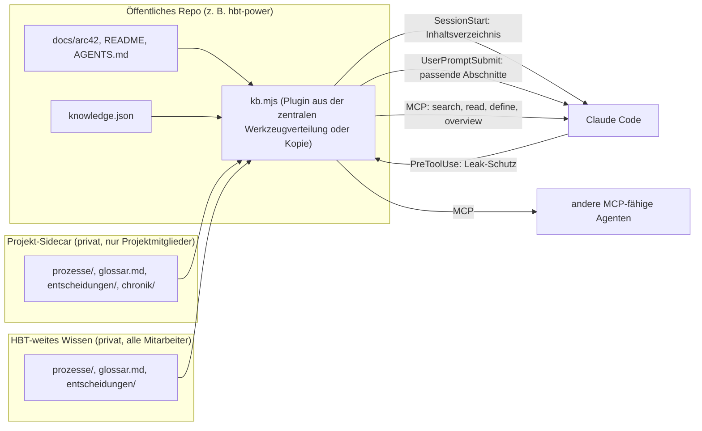
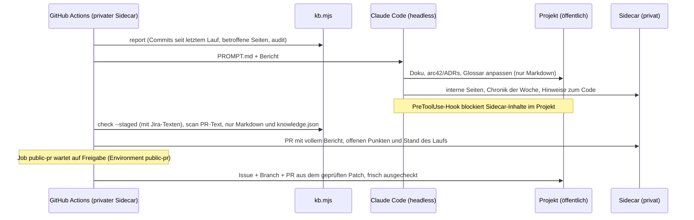

# Wissensbasis (Unified Knowledge Base)

## Kurz gesagt

Agenten wie Claude Code sollen ein Projekt so verstehen wie ein erfahrenes Teammitglied: die Architektur, die Fachbegriffe und auch die internen Abläufe. Die öffentliche Doku liegt schon im Repository. Internes Wissen, etwa fachliche Prozesse, darf dort nicht stehen, weil das Repository öffentlich ist.

Die Wissensbasis führt alles zusammen. Internes Wissen liegt in privaten Repositories: je Projekt ein **Projekt-Sidecar**, den nur die Projektmitglieder lesen, und ein **HBT-weites Wissen** für alle Mitarbeiter. Agenten sehen beide Quellen gleichzeitig. Sie nutzen sie, ohne dass jemand daran denken muss. Interne Treffer sind deutlich als **INTERN** markiert. Ein Schutzmechanismus verhindert, dass interne Sätze in Commits, Issues, PRs oder öffentliche Dateien gelangen.

Alles bleibt normales Markdown, das Menschen auf GitHub oder in jedem Editor lesen können. Jede Seite beginnt mit einer Kurzfassung für Leser ohne Vorwissen.

## Anforderungen und Lösung

| Anforderung | Lösung |
|---|---|
| **Implizit genutzt** | Beim Start jeder Agenten-Session wird ein Inhaltsverzeichnis geladen. Zu jeder Frage werden passende Abschnitte automatisch vorgeschlagen. Dazu kommen Werkzeuge zum Suchen und Lesen (MCP), ein Skill und eine Regel in `AGENTS.md`. |
| **Out of the box für verschiedene Projekte** | Eine einzige Datei (`kb.mjs`), nur Node.js, keine Abhängigkeiten, als Plugin für eine zentrale Werkzeugverteilung aufgebaut oder per `kb.mjs init` in ein Repository kopiert. Das HBT-weite Wissen teilen sich alle Projekte, jedes Projekt hat seinen eigenen Sidecar. Ohne Konfiguration werden `README.md`, `*.md` im Wurzelverzeichnis und `docs/**` gelesen. |
| **Menschlich lesbar für alle Hintergründe** | Markdown statt Datenbank. Seitenvorlage mit „Kurz gesagt“ zuerst und „Für die Technik“ zuletzt. Jede Seite nennt ihre Zielgruppe (Wirtschaft, Fachlichkeit, Technik). Das Glossar erklärt Fachbegriffe und Code-Namen. |
| **Internes bleibt privat** | Private Repositories je Leserkreis (Projekt-Sidecar, HBT-weites Wissen). Interne Treffer tragen einen Warnhinweis. Ein Hook blockiert wörtliche Übernahmen und sensible Begriffe. `kb check` prüft das ganze Repository. |
| **Bestehende Doku einbinden** | arc42, Glossar, `README.md` und `AGENTS.md` bleiben, wo sie sind. Die Wissensbasis indiziert sie und ordnet ihnen per `knowledge.json` Zielgruppen zu. |

## Aufbau



`kb.mjs` liest bei jedem Aufruf frisch aus allen Quellen. Es gibt keinen Index, der veralten kann, und keinen Server, der laufen muss.

## Wie die Nutzung implizit wird

1. **SessionStart-Hook:** Jede Session beginnt mit einem kompakten Inhaltsverzeichnis: Titel, id und Zielgruppe jeder Seite. Dazu kommen die Regeln für interne Inhalte. Der Agent weiß damit, was es gibt, bevor er fragt.
2. **UserPromptSubmit-Hook:** Zu jeder Nutzerfrage sucht die Wissensbasis die besten Abschnitte. Bei klaren Treffern hängt sie bis zu vier Verweise mit Ausschnitt an die Frage an. Bei schwachen Treffern bleibt sie still.
3. **MCP-Server `knowledge`:** Werkzeuge `search`, `read`, `define` und `overview`. Dazu kommt jede Seite als Ressource (`kb://public/…`, `kb://intern/…`), die man in Claude Code mit `@` einbinden kann. Jeder MCP-fähige Agent kann den Server nutzen.
4. **Skill `knowledge`:** beschreibt, wann und wie nachgeschlagen wird und wohin neues Wissen gehört.
5. **`AGENTS.md`:** Ein kurzer Abschnitt gibt dieselbe Regel auch Agenten ohne Hooks und MCP. Die Befehle laufen auch über die Kommandozeile.

## Wissensquellen und Leserkreise

Wissen hat verschiedene Leserkreise. Deshalb liegt es in getrennten Repositories, denn nur an Repo-Grenzen setzt Git Leserechte zuverlässig durch:

| Quelle | Wer darf lesen | Kennzeichen | Inhalt | Entscheidungen |
|---|---|---|---|---|
| **Projekt-Repo** (öffentlich) | alle | – | Code, arc42, `AGENTS.md`, Glossar der Oberfläche | `ADR-nn` |
| **Projekt-Sidecar** (privat, je Projekt) | nur Projektmitglieder | `[INTERN]` | fachliche Prozesse und Kontext des Projekts, Chronik, Stand des Nachtlaufs | `ADR-Inn` |
| **HBT-weites Wissen** (privat, ein Repo für alle) | alle Mitarbeiter | `[INTERN:HBT]` | HBT-weite Prozesse, gemeinsame Domänensprache, HBT-weite Entscheidungen | `ADR-HBT-nn` |

Agenten sehen alle drei Quellen als **eine** Wissensbasis: eine Suche, ein Glossar, ein Entscheidungsregister. Jeder Treffer nennt seine Herkunft. Mehrere Projekte nutzen dasselbe HBT-weite Wissen, ohne etwas zu kopieren. Jedes Projekt hat seinen eigenen Sidecar, und fremde Projekt-Sidecars werden nie geladen.

**Projekt-Sidecar** (`kb.mjs init-sidecar <ordner>`). Die Wissensbasis nimmt den ersten vorhandenen Ordner:

1. Umgebungsvariable `KB_PRIVATE_DIR`
2. `.knowledge.local.json` im Projekt mit `{"privateDir": "…"}` (gitignored)
3. Nachbarordner `../<repo-ordner>-knowledge`, z. B. `../<projekt>-knowledge`
4. Nachbarordner `../<name aus knowledge.json>-knowledge`
5. `.knowledge-intern/` im Projekt (gitignored), falls ein Werkzeug nur den Projektordner sieht

**HBT-weites Wissen** (`kb.mjs init-sidecar <ordner> --company`):

1. Nachbarordner, deren `knowledge.json` `"level": "company"` sagt (automatisch; aus mit `KB_DISCOVER=0`)
2. `KB_SOURCES="<ordner>"`, `.knowledge.local.json` mit `{"sources": [{"dir": "…"}]}`
3. einmal je Rechner `~/.config/knowledge/sources.json` mit demselben Format

Das öffentliche Repository nennt weder Namen noch Adressen der privaten Quellen. Wer keinen Zugriff hat, arbeitet ohne Fehler mit dem öffentlichen Wissen weiter. Deshalb sind die Quellen bewusst keine Git-Submodule.

**Regeln zwischen den Quellen:**

- **Domänensprache:** Das HBT-Glossar gilt überall, auch in öffentlicher Doku und in Oberflächentexten. Ein Projekt darf einen Begriff für sich enger fassen. Dann gilt seine Definition, und das Audit weist darauf hin. Vertrauliche Namen gehören in `sensitiveTerms`, nicht ins Glossar.
- **Leak-Schutz nach Leserkreis:** Inhalte dürfen nur dorthin, wo höchstens dieselben Leute lesen. Projektwissen darf nicht ins HBT-Wissen, keins von beiden in das öffentliche Projekt. Der Hook prüft jedes Schreiben nach diesem Prinzip.
- **Entscheidungen:** Eine Entscheidung darf nur auf Entscheidungen aufbauen, die ihre Leser auch sehen. Eine HBT-weite Entscheidung, die eine Projektentscheidung ablöst, meldet das Audit.

## Format einer Seite

```markdown
---
title: Profil vor Angebot
summary: Ein Satz, den auch jemand ohne Vorwissen versteht.
audience: [business, domain]     # business = Wirtschaft, domain = Fachlichkeit, tech = Technik
tags: [vertrieb]
owner: Team Vertrieb             # Rolle oder Team, keine Personennamen
reviewed: 2026-11-09             # nach 12 Monaten meldet `kb status` die Seite
---

# Profil vor Angebot

## Kurz gesagt
## Ablauf und Regeln
## Für die Technik
## Begriffe
## Bezüge
```

In `knowledge.json` bekommt jede Quelle per Glob eine Zielgruppe, optional eine Kurzfassung (`summary`) und ein Gewicht für die Suche (`boost`, Standard 1). Die erste passende Quelle gilt.

Alle Kopfdaten sind freiwillig. Seiten ohne Kopfdaten, wie die arc42-Kapitel, funktionieren trotzdem. Der Titel kommt dann aus der Überschrift, die Kurzfassung aus dem ersten Absatz und die Zielgruppe aus `knowledge.json`. Begriffe sind eigene Notizen (siehe Domänensprache). Glossar-Tabellen (`| **Begriff** (`Code`) | Bedeutung | Nicht verwenden |`) werden weiter gelesen.

`kb.mjs new public|intern|hbt <pfad> --title "…"` legt eine Seite aus der [Vorlage](templates/page.md) an. In privaten Quellen verlinkst du mit `[[…]]`, im Code-Repo mit Markdown-Links.

## Domänensprache

Damit Menschen und Agenten dieselbe Sprache sprechen und Begriffe überall gleich verlinkt sind, ist das Glossar **verbindlich**: ein Begriff je Sache. **Jeder Begriff ist eine eigene Notiz.**

| Wo | Ordner | Verknüpfung |
|---|---|---|
| öffentlich, Code-Repo | `docs/glossar/` (`terms.dir` in `knowledge.json`) | normale Markdown-Links: `[Berater](../glossar/Berater.md)` |
| Projekt-Sidecar, HBT-weites Wissen | `Begriffe/` | Obsidian-Links: `[[Berater]]`, `[[hbt/Begriffe/Berater\|Berater]]` |

```markdown
---
type: begriff
aliases: ["Beraterin"]             # weitere Namen, unter denen Obsidian den Begriff verlinkt
code: ["Consultant"]               # Namen im Code
nicht-verwenden: ["Consultant-Profil"]   # ersetzte Wörter
tags: [begriff]
---

# Berater

Mitarbeiterin oder Mitarbeiter der HBT mit Profil. Der erste Absatz ist die Definition.
```

- **Dateiname = Begriff:** Daran löst Obsidian `[[Berater]]` auf. Zeichen, die Dateinamen nicht erlauben (`/`, `:` …), werden zu `-`. Der echte Name steht dann unter `title`.
- **Anlegen:** `kb.mjs term public|intern|hbt "Name" --definition "…" --code A --avoid X`, oder in Obsidian mit der Vorlage „Begriff“.
- **Übersicht:** arc42 Kapitel 12 enthält eine Tabelle aller öffentlichen Begriffe zwischen `<!-- kb:begriffe -->` und `<!-- /kb:begriffe -->`. Sie wird erzeugt: `kb.mjs terms --index`, oder automatisch nach `term public`.
- **Umstieg:** `kb.mjs terms --to-notes docs/glossar --from <glossar.md>` überführt eine Glossar-Tabelle in Notizen. Links auf die alten Zeilen zeigen danach auf die Notizen.

So wird die Sprache durchgesetzt:

| Wo | Was |
|---|---|
| Session-Kontext | Die Domänensprache steht kompakt im Kontext jeder Session: Begriff, Code-Name und Wörter, die nicht verwendet werden sollen. |
| `define` | `define Mitarbeiter` antwortet bei einem ersetzten Wort: „gehört nicht zur Domänensprache, verwende …“. |
| `audit` | Meldet Wörter aus `nicht-verwenden` in der Doku und in den Dateien unter `terminology.scan`, hier den Oberflächentexten `de-DE.json`. Geprüft werden nur Seiten in der Sprache des Glossars; englische Seiten bekommen `"language": "en"`. Code in Backticks und Wörter, die nur als Wort erwähnt werden („…“, *…*), zählen nicht. Außerdem meldet es doppelt definierte Begriffe, Widersprüche und Code-Namen, die es im Code nicht mehr gibt. |
| Wöchentlicher Lauf | Nimmt neue Begriffe auf, ersetzt Abweichungen und verlinkt neue Erwähnungen. Ist unklar, welcher Begriff gilt, entscheidet er nicht, sondern fragt im Bericht nach. |

## Obsidian und Verknüpfungen

Das Wissen ist Markdown für Obsidian. Verknüpfungen zwischen Seiten, Begriffen und Entscheidungen sind so wichtig wie der Text. Deshalb liest die Wissensbasis sie mit:

- **Obsidian-Links** in den privaten Quellen: `[[Seite]]`, `[[Seite#Abschnitt]]`, `[[Seite#^block]]`, `[[Seite|Text]]`, `![[Bild.png]]`. Sie werden aufgelöst wie in Obsidian: über Dateiname, `aliases` oder Pfad. Ein Pfad darf mit dem Modulordner beginnen (`[[hbt/…]]`).
- **Markdown-Links** im öffentlichen Code-Repo, weil GitHub keine `[[…]]` darstellt. `[[…]]` dort meldet das Audit.
- **Schlagworte:** `#vertrieb`, `#prozess/angebot` im Text und `tags:` in den Kopfdaten. Issue-Nummern wie `#255` sind keine Schlagworte.
- **Rückverweise:** `read` zeigt zu jeder Seite Schlagworte, ausgehende Verknüpfungen und Rückverweise. Gut verknüpfte Seiten stehen in der Suche etwas weiter oben.
- **Audit:** Es meldet Verknüpfungen ins Leere, mehrdeutige Verknüpfungen, unbekannte Abschnitte und Blöcke sowie Verknüpfungen zu einem engeren Leserkreis (z. B. HBT-weit → Projekt). Verknüpfungen in ein Modul, das dem Leser fehlt, stehen getrennt. Sie sind kein Fehler.

**Modularer Vault:** `kb.mjs vault <ordner> --register` legt einen Vault-Ordner an, mit Obsidian-Einstellungen, Vorlagen (Seite, Begriff, Entscheidung) und Anleitung. Die privaten Repos werden als Module hineingeklont, jeder nur die, die er lesen darf:

```
HBT-Wissen/          Vault: .obsidian/, _vorlagen/, README.md
  hbt/               HBT-weites Wissen (alle Mitarbeiter)
  hbt-power/         Projekt-Sidecar (nur Projektmitglieder)
```

Die Ordnernamen stehen als `module` in der `knowledge.json` der Module. `--register` trägt den Vault in `~/.config/knowledge/sources.json` ein. Danach lädt jedes Projekt das HBT-weite Modul und sein eigenes Projektmodul (`project` in dessen `knowledge.json`), keine fremden.

## Entscheidungen

Entscheidungen sind eigene Wissenseinheiten und kein Text, den man irgendwo findet. Öffentliche ADRs (arc42 Kapitel 9) und interne Entscheidungen aus dem Sidecar bilden **ein gemeinsames Register**:

| Wo | Format | Nummer |
|---|---|---|
| öffentlich, arc42 Kapitel 9 | Abschnitt `## ADR-07: Titel` mit `- **Status:**`, `- **Kontext:**`, `- **Entscheidung:**`, `- **Konsequenzen:**`, dazu eine Zeile in der Übersichtstabelle | `ADR-01` … |
| intern, `entscheidungen/` im Projekt-Sidecar bzw. im HBT-weiten Wissen | eigene Seite mit `type: decision`, `id`, `status`, `issues` in den Kopfdaten ([Vorlage](templates/decision.md)) | `ADR-Inn` bzw. `ADR-HBT-nn` |

Erlaubte Status sind `vorgeschlagen`, `gilt`, `übernommen`, `abgelöst` und `verworfen`, optional mit Zusatz („gilt; Ablösung wird untersucht (#64)“). Eine Ablösung schreibt man als „abgelöst durch ADR-nn“ bzw. „löst ADR-nn ab“.

- **Nachschlagen:**
  - `decisions [thema] [--status gilt]` listet das Register, auch als MCP-Tool `decisions`.
  - `read ADR-07` liest eine Entscheidung.
  - Die Suche zeigt Entscheidungen mit ihrem Status.
  - Der Session-Kontext enthält alle Entscheidungen kompakt.
- **Anlegen:** `decide public "Titel" --issues "#12"` vergibt die nächste Nummer, schreibt den Abschnitt und die Zeile in der Übersicht. `decide intern "Titel"` bzw. `decide hbt "Titel"` legt `entscheidungen/ADR-….md` in der privaten Quelle an.
- **Prüfen:** `audit` meldet folgende Probleme:
  - Abschnitte ohne Zeile in der Übersicht und umgekehrt
  - abweichende Status oder Titel
  - unbekannte Status
  - Lücken und doppelte Nummern
  - fehlende Teile (Kontext, Entscheidung, Konsequenzen)
  - „abgelöst“ ohne Nachfolger
  - Verweise auf unbekannte Entscheidungen
  - Links auf Abschnitte, die es nicht gibt
  - öffentliche Verweise auf `ADR-I…`
- **Wöchentlicher Lauf:** `changes` nennt die Entscheidungen, deren Issues im Zeitraum bearbeitet wurden. Der Lauf prüft, ob sie noch stimmen, und legt neue mit `decide` an.

## Issue-Tracker: GitHub und Jira

HBT Power führt seine Issues öffentlich auf GitHub (`#123`). Die meisten anderen Projekte nutzen Jira (`PWR-123`). Die Wissensbasis versteht beides:

- **Projektschlüssel** stehen in der `knowledge.json` des Projekt-Sidecars: `"jira": {"keys": ["PWR"]}`. Nur diese Schlüssel gelten als Verweis. `ADR-07` ist deshalb kein Jira-Vorgang.
- **Verweise:** Commits, ADRs (`issues`, Status) und der Bericht des Nachtlaufs erkennen `#123` und `PWR-123`. Damit findet `changes` auch die Entscheidungen zu den Jira-Vorgängen des Zeitraums.
- **Lesen:** `kb jira PWR-123` liefert Beschreibung, Status, verknüpfte Vorgänge und Kommentare, ohne Personennamen. `kb jira --since -14d` listet geänderte Vorgänge. Der Zugriff ist nur lesend über die Jira-REST-API. Der Zugang kommt aus der Umgebung: `JIRA_URL`, `JIRA_TOKEN` und bei Jira Cloud `JIRA_USER` (E-Mail); ohne `JIRA_USER` wird der Token als Bearer-Token geschickt (Server/Data Center). Die Jira-Adresse gehört nie ins öffentliche Repo.
- **Nachtlauf:** Mit `vars.JIRA_URL` und `secrets.JIRA_TOKEN` im Sidecar enthält der Bericht die Jira-Vorgänge seit dem letzten Lauf. Der Agent liest sie mit `kb jira`.
- **Leserkreis:** Jira-Inhalte sind intern, Ebene Projekt. Sie dürfen in den Projekt-Sidecar, nie ins öffentliche Repo.

Für die Arbeit im Chat deckt der Atlassian-Connector Jira und Confluence ab, mit den Rechten des Nutzers.

## Leak-Schutz

| Ebene | Was sie tut | Grenze |
|---|---|---|
| Kennzeichnung | Interne Treffer tragen `[INTERN]` und einen Warnhinweis. Server, Skill und `AGENTS.md` verbieten die Übernahme. | Hängt davon ab, dass der Agent sich daran hält. |
| PreToolUse-Hook | Blockiert `git commit/push`, `gh issue/pr/…` sowie `Write`/`Edit` im öffentlichen Repo (Bash und PowerShell). Das geschieht, wenn darin ein Satz ab 40 Zeichen aus dem Sidecar oder ein Begriff aus `sensitiveTerms` vorkommt. Bei `git commit -a` oder einem `git add` im selben Befehl prüft er alle Änderungen gegenüber `HEAD` samt neuer Dateien, bei `git push` die Commits, die das Remote noch nicht hat. Dateien in UTF-16, wie sie PowerShell 5 mit `echo >` schreibt, hält Git für binär; Hook und `kb check` lesen sie trotzdem. Gitignorierte Dateien und der Sidecar selbst sind frei. | Erkennt wörtliche Übernahmen, keine Umschreibungen. Schreibt ein anderer Befehl (z. B. `echo >`) in eine Datei, greift erst die Prüfung beim Commit. |
| `kb check` | Prüft alle versionierten Dateien. `--staged` prüft nur den nächsten Commit, z. B. als Git-Pre-Commit-Hook. `--extra <datei>` nimmt weitere interne Texte dazu, die keine Seiten sind, etwa aus Jira (`KB_JIRA_LOG` sammelt sie beim Lesen). Ohne Sidecar, etwa in CI, prüft es nur, dass keine Seite mit `visibility: intern` im öffentlichen Repo liegt. | Wie oben. |

Als öffentlich gilt nur, was in `HEAD` committet ist. Ein Satz aus dem Sidecar, der gerade in eine öffentliche Seite geschrieben oder gestaged wurde, bleibt ein Fund, bis er bewusst committet ist.

Sensible Namen wie Kunden oder interne Systeme gehören in `sensitiveTerms` in der `knowledge.json` des Sidecars. So werden sie auch in Umschreibungen erkannt.

## Werkzeug und Verteilung

Inhalte und Werkzeug sind getrennt. Das Werkzeug ist dieser Ordner und hängt von keinem Projekt ab. Er ist zugleich ein **Claude-Code-Plugin** (`.claude-plugin/plugin.json`, `hooks/hooks.json`, `.mcp.json`, `skills/knowledge/`) und soll künftig **zentral verteilt** werden. Bis diese Verteilung feststeht, gibt es zwei Wege:

| Weg | Im Projekt | Update |
|---|---|---|
| **Plugin** (Ziel) | nur `knowledge.json` (welche Doku, Zielgruppen, Domänensprache) | über die zentrale Werkzeugverteilung, eine Version für alle Projekte |
| **Kopie** (heute in hbt-power) | `tools/knowledge/`, Hooks in `.claude/settings.json`, `.mcp.json`, Skill | `node <werkzeug>/kb.mjs init <projekt> --update` bringt die Kopie auf die Version des Werkzeugs |

Beide Wege zugleich führen zu doppelten Hooks. Ein Projekt nutzt deshalb nur einen.

**Projekt einrichten (Kopie):**

```bash
node <werkzeug>/kb.mjs init /pfad/zum/projekt --name mein-projekt
```

Der Befehl kopiert das Werkzeug. Dazu legt er `knowledge.json`, `.mcp.json`, die Hooks, den Skill, `.gitignore` und einen Abschnitt in `AGENTS.md` an oder ergänzt sie. Vorhandene Einträge bleiben erhalten.

**Private Quellen einrichten:**

```bash
node tools/knowledge/kb.mjs init-sidecar ../<projekt>-knowledge     # Projekt-Sidecar, privates Repo des Projekts
node tools/knowledge/kb.mjs init-sidecar ../<firmenwissen> --company   # HBT-weites Wissen, einmal für alle
node tools/knowledge/kb.mjs status
```

**Andere MCP-Clients** (Claude Desktop, IDE-Plugins) bekommen den Server mit absolutem Pfad:

```json
{ "mcpServers": { "knowledge": { "command": "node", "args": ["<werkzeug>/kb.mjs", "mcp", "--root", "<projekt>"] } } }
```

## Wöchentliche Konsolidierung

Code ändert sich jede Woche, Wissen veraltet still. Deshalb gleicht ein Lauf jede Nacht von Samstag auf Sonntag Code und Wissen ab:

- Er **aktualisiert** Überholtes.
- Er **entfernt** Veraltetes.
- Er **dokumentiert** neue Entscheidungen und Begebenheiten.

Das Ergebnis kommt als Pull Requests, die Menschen prüfen. Der PR im öffentlichen Projekt entsteht erst, nachdem ein Mensch die Änderungen freigegeben hat: Ein Branch dort ist schon öffentlich, und die Leak-Prüfung erkennt keine Umschreibungen.



Es gibt **einen Lauf je Projekt**, im Projekt-Sidecar. Das HBT-weite Wissen liest er nur. Was dort geändert werden sollte, steht als Vorschlag im Bericht und enthält keine Projektinhalte.

**Sicherheit:** Der Lauf führt nie Code aus dem öffentlichen Projekt aus. Werkzeug, Prompt, Hooks und MCP-Server kommen aus einer freigegebenen Version des Werkzeug-Repos, festgelegt als voller Commit-SHA (`vars.KB_TOOL_REPO`, `vars.KB_TOOL_REF`). Claude läuft ohne die Einstellungen des Projekts (`--setting-sources user`, `--strict-mcp-config`). Das Projekt ist nur Arbeitsmaterial. Sonst könnte ein gemergter PR im öffentlichen Repo internes Wissen abziehen.

Der Lauf ist auf vier Bausteine verteilt:

- **Deterministische Eingaben:** `kb.mjs report` sammelt drei Dinge. Erstens die Commits und Issues seit dem letzten Lauf; den Stand merkt sich der Sidecar in `consolidation/state.json`. Zweitens die Seiten, die gelöschte, umbenannte oder geänderte Dateien erwähnen. Drittens die Ergebnisse von `kb.mjs audit`: Links ins Leere, Pfade, die es nicht mehr gibt, Bezeichner wie `ViewProfile`, die im Code fehlen, unbekannte Wissens-ids, Seiten ohne Kurzfassung oder Zielgruppe und Seiten, die länger als 12 Monate nicht geprüft wurden. Fehlalarme kommen in `auditIgnore` in `knowledge.json`.
- **Agent:** Claude Code arbeitet nach [`consolidate/PROMPT.md`](consolidate/PROMPT.md).
  - Er liest jeden Commit mit Issue und PR und ordnet ihn ein: ADR, arc42-Kapitel, Glossar oder Sidecar.
  - Er prüft die gemeldeten Seiten am Code und schreibt eine Chronik der Woche für Wirtschaft und Fachlichkeit (`chronik/<JJJJ>-KW<nn>.md` im Sidecar).
  - Im Projekt ändert er nur Markdown-Dateien und `knowledge.json`. Code fasst er nie an, auch keine Kommentare und Oberflächentexte. Was dort nicht stimmt, schreibt er als **Hinweis zum Code** in den Projekt-Sidecar (`consolidation/hints.md`: Datei und Zeile, was falsch ist, Vorschlag), ohne interne Inhalte, denn die Hinweise landen später in öffentlichem Code. Er ersetzt die Datei bei jedem Lauf als Ganzes.
  - `kb status` und der Session-Kontext zeigen die offenen Hinweise. Wer in dem Bereich arbeitet, behebt den Kommentar im selben Branch als kleine Korrektur nebenbei (Regel „Small fixes along the way“ in `AGENTS.md`) und löscht den Hinweis aus der Datei im Sidecar.
  - Was er nicht belegen kann, schreibt er unter „Offene Punkte“.
  - Er darf weder committen noch PRs anlegen.
- **Workflow:** [`templates/sidecar/github/workflows/consolidate.yml`](templates/sidecar/github/workflows/consolidate.yml). Er läuft im privaten Sidecar, weil der Agent internes Wissen liest und Actions-Logs eines öffentlichen Repositorys öffentlich sind. Nach der Leak- und Umfangsprüfung legt er den geprüften Patch ab und den Sidecar-PR an. Erst wenn ein Prüfer den Job `public-pr` im Environment `public-pr` freigibt, checkt dieser das Projekt frisch aus, wendet den Patch an und legt ein Issue, einen Branch, einen Commit und einen PR an, nach den Regeln aus `AGENTS.md`. Was der Agent in `.git` geschrieben hat (Hooks, Konfiguration), erreicht diesen Commit nicht. Schlägt eine Prüfung an, bleibt der Stand des Laufs stehen, und der nächste Lauf nimmt dieselben Commits wieder auf. Die PRs lösen im Projekt die normale CI aus. Der Sidecar-PR enthält den vollen Bericht.
- **Manuell:** Unter *Actions → Wissen konsolidieren → Run workflow* lässt sich der Lauf von Hand starten, optional mit eigenem Zeitraum oder als Probelauf ohne PRs.

**Einrichten im Sidecar:**

1. `init-sidecar` legt den Workflow mit an.
2. Variablen `KB_TOOL_REPO` und `KB_TOOL_REF` (freigegebener Commit des Werkzeugs) setzen; optional `COMPANY_KNOWLEDGE_REPO` mit Secret `COMPANY_KNOWLEDGE_TOKEN` (nur lesen) für das HBT-weite Wissen.
3. Unter *Settings → Environments* das Environment `public-pr` mit *Required reviewers* anlegen. Dort als Environment-Secret `PROJECT_TOKEN` hinterlegen: ein Fine-grained Token nur für das Projekt, mit Lese- und Schreibrecht für Contents, Pull requests und Issues. So bekommt nur der freigegebene Job das Schreibrecht.
4. Unter *Settings → Secrets and variables → Actions* folgendes setzen:
   - `PROJECT_REPO` als Variable, z. B. `HBTGmbH/hbt-power`
   - optional `PROJECT_READ_TOKEN` als Secret (nur lesen), falls das Projekt privat ist
   - `ANTHROPIC_API_KEY` oder `CLAUDE_CODE_OAUTH_TOKEN` als Secret
   - optional `ISSUE_TYPE_ID` mit dem Issue-Typ „Task“ aus `AGENTS.md`
5. Unter *Settings → Actions → General* „Allow GitHub Actions to create and approve pull requests“ einschalten.

Lokal ausprobieren lassen sich die Eingaben mit diesem Befehl:

```bash
KB_PRIVATE_DIR=../<projekt>-knowledge node tools/knowledge/kb.mjs report --since "30 days ago"
```

## Befehle

```text
node tools/knowledge/kb.mjs search "<frage>" [--audience business|domain|tech] [--scope all|public|intern]
node tools/knowledge/kb.mjs read public:docs/arc42/05-bausteinsicht.md#edge
node tools/knowledge/kb.mjs define Kürzel
node tools/knowledge/kb.mjs overview --audience business
node tools/knowledge/kb.mjs status
node tools/knowledge/kb.mjs check [--staged] [--extra jira.md]
node tools/knowledge/kb.mjs scan pr-text.md
node tools/knowledge/kb.mjs terms [--index | --to-notes <ordner> --from <datei>]
node tools/knowledge/kb.mjs term public|intern|hbt "Begriff" [--definition "…"] [--code A] [--avoid X]
node tools/knowledge/kb.mjs vault <ordner> [--register]
node tools/knowledge/kb.mjs jira PWR-123 | --since -14d
node tools/knowledge/kb.mjs decisions [thema] [--status gilt] [--scope intern]
node tools/knowledge/kb.mjs read ADR-09
node tools/knowledge/kb.mjs decide public|intern "Titel" [--issues "#12"]
node tools/knowledge/kb.mjs audit
node tools/knowledge/kb.mjs changes [--since <commit|datum>]
node tools/knowledge/kb.mjs report [--since …] [--out bericht.md]
node --test tools/knowledge/test/*.test.mjs
```

## Grenzen und nächste Schritte

- **Suche:** BM25 über Abschnitte mit einfacher deutscher Wortstamm-Bildung und Teilwort-Treffern für Komposita. Das reicht für einige hundert Seiten. Eine semantische Suche mit Embeddings ließe sich hinter `search` ergänzen, ohne das Format zu ändern.
- **Rückfluss:** Der Skill schlägt vor, neues Wissen festzuhalten. Ein Review-Schritt, wer Sidecar-Seiten freigibt, ist noch offen.
- **Verteilung:** Wie Plugins zentral verteilt werden, steht noch nicht fest. Das Werkzeug ist schon als Plugin aufgebaut und braucht im Projekt dann nur noch `knowledge.json`.
